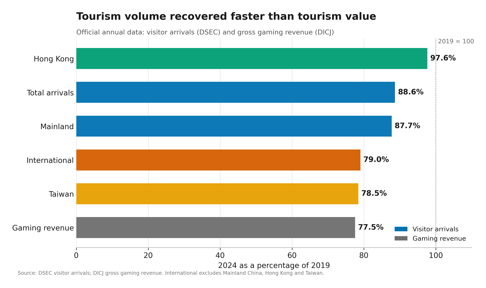
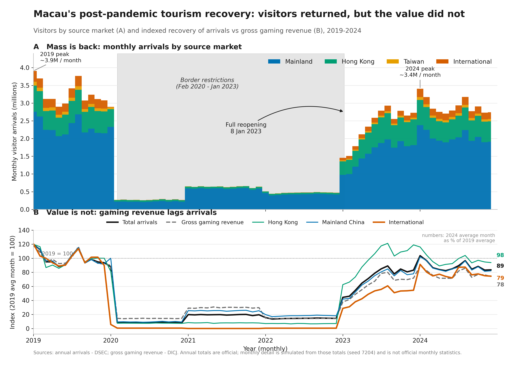

# Zhoujinasdff

I am a data science student based in Macau. I use Python to turn public data into clear, honest visual stories, with a particular interest in exploratory analysis, data visualization, and reproducible workflows.

**Technical skills:** Python, pandas, NumPy, Matplotlib, seaborn, Jupyter, data cleaning, exploratory data analysis, data visualization, Git and GitHub.

---

## Project showcase

### Macau's Post-Pandemic Tourism Recovery

**Research question:** By 2024, how far had Macau's visitor arrivals and gross gaming revenue recovered relative to 2019, and which source markets lagged?

**Status:** Completed (October 2026)

| Project at a glance | |
|---|---|
| **Question** | Did Macau's visitor arrivals and gross gaming revenue recover to 2019 levels by 2024? |
| **Data** | DSEC annual visitor arrivals; DICJ gross gaming revenue |
| **Method** | Compare 2024 with 2019 using a 2019 = 100 index |
| **Main finding** | Arrivals recovered to 88.6%; gaming revenue to 77.5% |
| **Limitation** | Annual data cannot separate spending changes from visitor-mix changes; the monthly detail in the second figure is simulated |

The chart compares 2024 with 2019 for total arrivals, each source market, and gross gaming revenue. Visitor volume recovered to **88.6%** of the 2019 level, but gaming revenue recovered to only **77.5%**. The gap is the main finding: the visitors came back faster than the value they generated.

Recovery also differed by market. Hong Kong returned to **97.6%** of its 2019 level, Mainland China to **87.7%**, international visitors to **79.0%**, and Taiwan to **78.5%**. In 2024, **54.1%** of arrivals were same-day visitors and the average stay was **1.2 days**, a mix that is consistent with lower spending per arrival, although annual data cannot prove that explanation.

The figure below shows the monthly path and the indexed comparison. The monthly detail is simulated from official annual totals and is marked as illustrative; the annual values behind the main finding are official DSEC and DICJ figures.

**What I would improve next:** replace the simulated monthly detail with official monthly arrivals and visitor-spending tables, then estimate spending per visitor by source market. This would test the composition explanation directly instead of leaving it as an interpretation.

**Links:** [Project repository](https://github.com/zhoujinasdff/data-science-project) | [README and methods](https://github.com/zhoujinasdff/data-science-project#readme)

**Data note:** Annual visitor arrivals from DSEC and gross gaming revenue from DICJ. No personal or restricted data is used. The project repository documents the sources, permissions, and reproduction steps.
